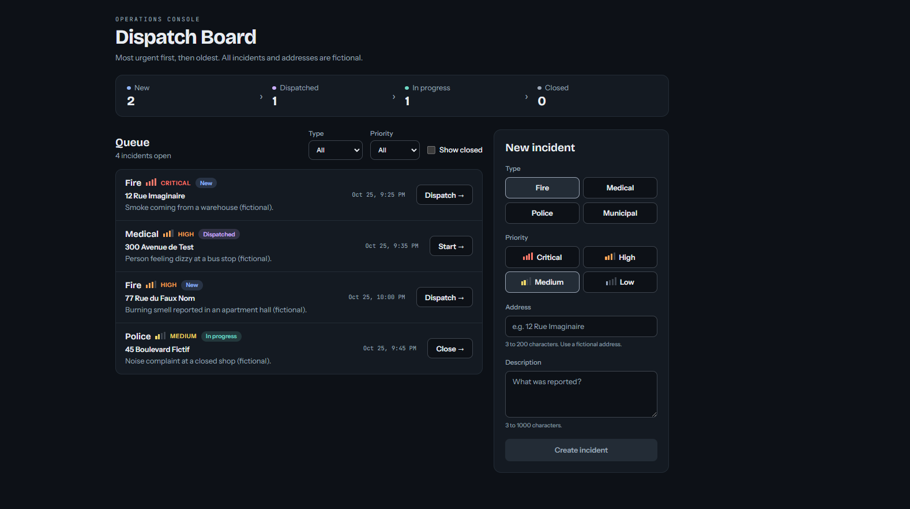

# Dispatch Board

Mini tableau de bord de répartition d'incidents d'urgence. **Toutes les données sont fictives.**
A small emergency-incident dispatch board. **All data is fictional.**



---

## Français

### Description

Dispatch Board est une application web où un opérateur enregistre des incidents fictifs (incendie, santé, police, municipal), voit une file d'attente triée par priorité et fait avancer chaque incident dans un cycle de vie : `New → Dispatched → InProgress → Closed`.

Le projet sert à pratiquer C# / ASP.NET Core et Angular sur un domaine proche d'un centre d'appels d'urgence, sans copier aucune organisation. Adresses, descriptions et jeux de données d'exemple sont inventés. Aucune donnée réelle ne doit être ajoutée.

### Architecture

```
 Opérateur (navigateur)
      │   Angular (TypeScript)              http://localhost:4200
      │      │  HTTP/JSON
      ▼      ▼
 API ASP.NET Core (C#)                      http://localhost:5080
      │  Controllers → Services → EF Core
      ▼
   SQLite (fichier dispatch.db)
```

Le contrôleur ne fait que le HTTP. Le service orchestre les cas d'utilisation. `IncidentRules` contient les règles pures (transition, tri), sans base de données. Les DTO sont le seul format qui sort de l'API.

| Couche | Technologie |
| --- | --- |
| API | ASP.NET Core Web API, C#, .NET 8 |
| Données | SQLite + Entity Framework Core (migrations) |
| Tests API | xUnit |
| Interface | Angular 21, TypeScript, composants standalone, signals, Reactive Forms |
| Tests interface | Vitest (`ng test`) |

Le temps réel (SignalR) est prévu, pas branché. Le CORS autorise déjà `http://localhost:4200` avec les identifiants, pour cette étape.

### Fonctionnalités

- Formulaire de création (type, priorité, adresse, description), bouton désactivé tant que le formulaire est invalide.
- File d'attente triée : priorité décroissante, puis date de création croissante. Couleur par priorité, pastille de statut.
- Bouton vers le prochain statut valide (`Dispatch`, `Start`, `Close`). Une transition invalide est refusée par l'API (409).
- Filtres par type, par priorité, et case « afficher les incidents fermés ».
- Données d'exemple insérées au démarrage, en Development seulement, et seulement si la base est vide.

### Lancer le projet

Prérequis : SDK .NET 8, Node.js LTS, Git, Angular CLI (`npm install -g @angular/cli`).

Deux terminaux, depuis la racine du dépôt.

API :

```bash
dotnet run --project backend/src/Dispatch.Api
```

Interface :

```bash
cd frontend/dispatch-web && npm install && ng serve
```

- Interface : http://localhost:4200
- API : http://localhost:5080
- Swagger (Development) : http://localhost:5080/swagger

En Development, l'API applique les migrations et sème la base au démarrage. Le fichier `dispatch.db` est créé à côté du projet API ; il ne doit pas être commité.

### Tests

Depuis `backend/` :

```bash
dotnet test
```

Les tests xUnit couvrent la machine à états, le tri et le service (création, filtres, transitions, 409).

Depuis `frontend/dispatch-web/` :

```bash
ng test
```

Les fichiers `.spec.ts` sont encore les gabarits du CLI Angular. `app.spec.ts` cherche le titre par défaut « Hello, dispatch-web », alors que l'écran affiche « Dispatch Board » : `ng test` peut donc échouer tant que ces tests ne sont pas réécrits.

### Endpoints

Base : `http://localhost:5080`. JSON en `camelCase`. Les enums sont des chaînes (`"Critical"`, `"Fire"`).

| Méthode | Route | Rôle | Succès | Erreurs |
| --- | --- | --- | --- | --- |
| `POST` | `/api/incidents` | Crée un incident (`New`) | `201` + `IncidentDto` + `Location` | `400` validation |
| `GET` | `/api/incidents` | Liste triée. Query : `status`, `priority`, `type`, `includeClosed` | `200` + tableau | `400` enum invalide |
| `GET` | `/api/incidents/{id}` | Un incident | `200` | `404` |
| `PATCH` | `/api/incidents/{id}/status` | Change le statut. Corps : `{ "status": "Dispatched" }` | `200` | `404`, `400`, `409` transition invalide |

`GET /hubs/incidents` (SignalR) figure au contrat, mais le hub n'est pas encore mappé.

Exemple de création :

```json
{
  "type": "Fire",
  "priority": "High",
  "address": "12 Rue Imaginaire",
  "description": "Smoke coming from a warehouse (fictional)."
}
```

### Règles d'affaires

Machine à états linéaire. Seul le pas suivant est valide. Tout le reste, y compris rester sur le même statut, répond **409**.

```
New ──► Dispatched ──► InProgress ──► Closed
```

| De \ Vers | New | Dispatched | InProgress | Closed |
| --- | --- | --- | --- | --- |
| **New** | ✗ | ✓ | ✗ | ✗ |
| **Dispatched** | ✗ | ✗ | ✓ | ✗ |
| **InProgress** | ✗ | ✗ | ✗ | ✓ |
| **Closed** | ✗ | ✗ | ✗ | ✗ |

À l'entrée dans `Closed`, `ClosedAt` est rempli (UTC). Chaque transition met à jour `UpdatedAt`.

Tri de la file :

1. `Priority` décroissante (`Critical` en premier).
2. À priorité égale, `CreatedAt` croissante (le plus ancien en premier).

`includeClosed` vaut `false` par défaut : les incidents `Closed` sont absents de la liste, sauf si `status=Closed` est demandé explicitement.

| Enum | Valeurs |
| --- | --- |
| `IncidentType` | `Fire`, `Medical`, `Police`, `Municipal` |
| `IncidentPriority` | `Low`, `Medium`, `High`, `Critical` |
| `IncidentStatus` | `New`, `Dispatched`, `InProgress`, `Closed` |

### Décisions de conception et prochaines étapes

- **Couches séparées.** Le contrôleur traduit HTTP. Les règles pures se testent sans base. Le service relie les deux. L'entité EF ne sort jamais telle quelle.
- **SQLite.** Aucun serveur à installer. Le même EF Core peut viser PostgreSQL ou SQL Server plus tard.
- **`DateTime` UTC, pas `DateTimeOffset`.** Le fournisseur SQLite d'EF Core trie mal `DateTimeOffset`.
- **Enums en entiers en base, en chaînes en JSON.** Les noms restent stables pour le client.
- **Tri en mémoire** après les filtres EF. Suffisant pour ce volume.
- **Hors portée volontaire :** authentification, modification, suppression, carte, Docker, CI.

Prochaines étapes :

- Authentification (JWT) et profils (opérateur, superviseur).
- Historique des changements de statut.
- Concurrence optimiste (`RowVersion`) : aujourd'hui, le dernier écrit gagne.
- Pagination et recherche texte.
- Carte des incidents.
- SignalR (`IncidentCreated`, `IncidentUpdated`) pour mettre à jour plusieurs onglets.
- Docker Compose et CI (`dotnet test`, `ng test`).
- Remplacer SQLite par PostgreSQL ou SQL Server.
- Tests d'intégration (`WebApplicationFactory`) et tests de bout en bout (Playwright).
- Client mobile (Flutter) sur la même API.

---

## English

### Description

Dispatch Board is a web app where an operator records fictional incidents (fire, medical, police, municipal), sees a priority-sorted queue, and moves each incident through a lifecycle: `New → Dispatched → InProgress → Closed`.

The project is practice for C# / ASP.NET Core and Angular, in a domain close to an emergency call centre, without copying any organization. Addresses, descriptions, and seed data are made up. Do not add real data.

### Architecture

```
 Operator (browser)
      │   Angular (TypeScript)              http://localhost:4200
      │      │  HTTP/JSON
      ▼      ▼
 ASP.NET Core API (C#)                      http://localhost:5080
      │  Controllers → Services → EF Core
      ▼
   SQLite (dispatch.db file)
```

The controller handles HTTP only. The service runs the use cases. `IncidentRules` holds the pure rules (transitions, sort) with no database. DTOs are the only shape the API returns.

| Layer | Technology |
| --- | --- |
| API | ASP.NET Core Web API, C#, .NET 8 |
| Data | SQLite + Entity Framework Core (migrations) |
| API tests | xUnit |
| UI | Angular 21, TypeScript, standalone components, signals, Reactive Forms |
| UI tests | Vitest (`ng test`) |

Real time (SignalR) is planned, not wired. CORS already allows `http://localhost:4200` with credentials for that step.

### Features

- Create form (type, priority, address, description). Submit stays disabled while the form is invalid.
- Queue sorted by priority descending, then created date ascending. Priority colour and a status badge.
- Button for the next valid status (`Dispatch`, `Start`, `Close`). The API rejects an invalid transition with 409.
- Filters by type, by priority, and a “show closed” checkbox.
- Sample rows inserted on startup in Development only, and only when the database is empty.

### Run

Prerequisites: .NET 8 SDK, Node.js LTS, Git, Angular CLI (`npm install -g @angular/cli`).

Two terminals, from the repository root.

API:

```bash
dotnet run --project backend/src/Dispatch.Api
```

UI:

```bash
cd frontend/dispatch-web && npm install && ng serve
```

- UI: http://localhost:4200
- API: http://localhost:5080
- Swagger (Development): http://localhost:5080/swagger

In Development the API applies migrations and seeds the database on startup. `dispatch.db` is created next to the API project; do not commit it.

### Tests

From `backend/`:

```bash
dotnet test
```

xUnit covers the state machine, the sort, and the service (create, filters, transitions, 409).

From `frontend/dispatch-web/`:

```bash
ng test
```

The `.spec.ts` files are still the Angular CLI scaffolds. `app.spec.ts` expects the default title “Hello, dispatch-web”, while the screen shows “Dispatch Board”, so `ng test` can fail until those tests are rewritten.

### Endpoints

Base URL: `http://localhost:5080`. JSON is `camelCase`. Enums are strings (`"Critical"`, `"Fire"`).

| Method | Route | Purpose | Success | Errors |
| --- | --- | --- | --- | --- |
| `POST` | `/api/incidents` | Create an incident (`New`) | `201` + `IncidentDto` + `Location` | `400` validation |
| `GET` | `/api/incidents` | Sorted list. Query: `status`, `priority`, `type`, `includeClosed` | `200` + array | `400` invalid enum |
| `GET` | `/api/incidents/{id}` | One incident | `200` | `404` |
| `PATCH` | `/api/incidents/{id}/status` | Change status. Body: `{ "status": "Dispatched" }` | `200` | `404`, `400`, `409` invalid transition |

`GET /hubs/incidents` (SignalR) is in the contract, but the hub is not mapped yet.

Create example:

```json
{
  "type": "Fire",
  "priority": "High",
  "address": "12 Rue Imaginaire",
  "description": "Smoke coming from a warehouse (fictional)."
}
```

### Business rules

Linear state machine. Only the next step is valid. Anything else, including staying on the same status, returns **409**.

```
New ──► Dispatched ──► InProgress ──► Closed
```

| From \ To | New | Dispatched | InProgress | Closed |
| --- | --- | --- | --- | --- |
| **New** | ✗ | ✓ | ✗ | ✗ |
| **Dispatched** | ✗ | ✗ | ✓ | ✗ |
| **InProgress** | ✗ | ✗ | ✗ | ✓ |
| **Closed** | ✗ | ✗ | ✗ | ✗ |

Entering `Closed` sets `ClosedAt` (UTC). Every transition updates `UpdatedAt`.

Queue sort:

1. `Priority` descending (`Critical` first).
2. Same priority: `CreatedAt` ascending (oldest first).

`includeClosed` defaults to `false`: `Closed` incidents stay out of the list unless `status=Closed` is requested.

| Enum | Values |
| --- | --- |
| `IncidentType` | `Fire`, `Medical`, `Police`, `Municipal` |
| `IncidentPriority` | `Low`, `Medium`, `High`, `Critical` |
| `IncidentStatus` | `New`, `Dispatched`, `InProgress`, `Closed` |

### Design decisions and next steps

- **Separate layers.** The controller maps HTTP. Pure rules are tested without a database. The service connects them. The EF entity is never returned as-is.
- **SQLite.** No database server to install. The same EF Core model can target PostgreSQL or SQL Server later.
- **UTC `DateTime`, not `DateTimeOffset`.** The EF Core SQLite provider does not sort `DateTimeOffset` reliably.
- **Enums stored as integers, serialized as strings.** Names stay stable for the client.
- **In-memory sort** after the EF filters. Enough for this data size.
- **Left out on purpose:** authentication, edit, delete, map, Docker, CI.

Next steps:

- Authentication (JWT) and roles (operator, supervisor).
- Status-change history.
- Optimistic concurrency (`RowVersion`): today, the last write wins.
- Pagination and text search.
- Incident map.
- SignalR (`IncidentCreated`, `IncidentUpdated`) so several tabs stay in sync.
- Docker Compose and CI (`dotnet test`, `ng test`).
- Replace SQLite with PostgreSQL or SQL Server.
- API integration tests (`WebApplicationFactory`) and end-to-end tests (Playwright).
- A mobile client (Flutter) on the same API.
